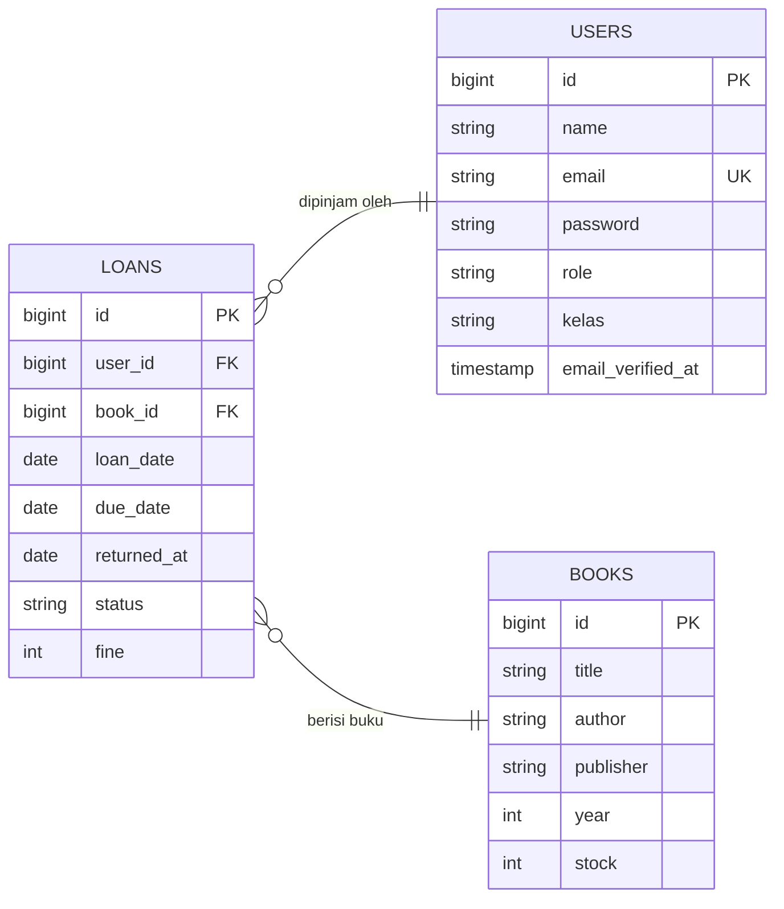

APLIKASI PEMINJAMAN BUKU
Laravel 12 & Filament 4

1. Deskripsi Program

Aplikasi Peminjaman Buku merupakan aplikasi berbasis web yang dibuat untuk membantu pengelolaan perpustakaan sekolah. Aplikasi ini digunakan untuk mengelola data buku, data pengguna, serta transaksi peminjaman dan pengembalian buku.

Aplikasi dikembangkan menggunakan Laravel 12 sebagai framework utama dan Filament 4 untuk mengelola data melalui panel administrasi.

Sistem memiliki dua jenis pengguna, yaitu admin dan siswa. Admin bertugas mengelola data perpustakaan, sedangkan siswa dapat melihat daftar buku, melakukan peminjaman, dan melihat riwayat peminjamannya.

Hak Akses Pengguna

| Pengguna | Hak Akses |
|---|---|
| Admin | Mengelola data buku, melihat transaksi peminjaman, dan mengelola akun pengguna. |
| Siswa | Melihat buku, melakukan peminjaman, dan melihat riwayat peminjaman sendiri. |

Akun yang melakukan pendaftaran melalui halaman Sign Up secara otomatis mendapatkan role siswa. Admin dapat dibuat melalui proses pengisian data awal menggunakan DatabaseSeeder.

Fitur Utama

| Fitur | Deskripsi |
|---|---|
| Login dan Registrasi | Digunakan untuk masuk dan membuat akun pengguna. |
| Manajemen Buku | Mengelola judul, penulis, penerbit, tahun terbit, dan stok buku. |
| Manajemen Pengguna | Mengelola akun admin dan siswa. |
| Peminjaman Buku | Memungkinkan siswa meminjam buku yang tersedia. |
| Pengembalian Buku | Memperbarui status peminjaman dan mengembalikan stok buku. |
| Perhitungan Denda | Menghitung denda berdasarkan jumlah hari keterlambatan. |
| Dashboard | Menampilkan informasi jumlah buku, anggota, dan peminjaman aktif. |

Ketentuan Peminjaman

- Maksimal 3 buku yang masih dipinjam oleh satu siswa.
- Lama peminjaman adalah 7 hari.
- Denda keterlambatan sebesar Rp1.000 per hari.
- Stok buku berkurang ketika peminjaman berhasil.
- Stok buku bertambah ketika buku dikembalikan.
- Status peminjaman berubah dari `dipinjam` menjadi `dikembalikan`.

### Teknologi yang Digunakan

| Teknologi | Kegunaan |
|---|---|
| PHP | Bahasa pemrograman aplikasi. |
| Laravel 12 | Framework untuk membangun aplikasi web. |
| Filament 4 | Membuat panel administrasi dan pengelolaan data. |
| MySQL | Menyimpan data aplikasi. |
| XAMPP | Menjalankan server lokal dan database. |
| Composer | Mengelola library PHP. |
| Blade | Template tampilan Laravel. |


2. Dokumentasi Fungsi/Prosedur

Bagian ini menjelaskan beberapa file, fungsi, dan bagian kode yang digunakan dalam aplikasi beserta kegunaannya.

A. Model User

Lokasi: `app/Models/User.php`

Model User digunakan untuk mengelola data akun admin dan siswa.

| Elemen | Jenis | Keterangan |
|---|---|---|
| $fillable | Properti | Menentukan kolom yang dapat diisi, seperti name, email, password, role, dan kelas. |
| $hidden | Properti | Menyembunyikan password dan remember_token ketika data diubah menjadi array atau JSON. |
| casts() | Fungsi | Mengatur tipe data dan melakukan hashing otomatis pada password. |
| isAdmin() | Fungsi | Memeriksa apakah pengguna memiliki role admin. |

Contoh fungsi:

```php
public function isAdmin(): bool
{
    return $this->role === 'admin';
}
```

Fungsi tersebut digunakan untuk membedakan admin dan siswa berdasarkan nilai role pada database.

B. Model Book

Lokasi: `app/Models/Book.php`

Model Book digunakan untuk mengelola informasi buku yang tersimpan di database.

| Elemen | Jenis | Keterangan |
|---|---|---|
| $fillable | Properti | Menentukan kolom buku yang dapat diisi, yaitu title, author, publisher, year, dan stock. |
| loans() | Relasi | Menghubungkan data buku dengan transaksi peminjaman jika relasi hasMany didefinisikan pada model. |

C. Model Loan

Lokasi: `app/Models/Loan.php`

Model Loan digunakan untuk menyimpan dan mengelola transaksi peminjaman buku.

| Elemen | Jenis | Keterangan |
|---|---|---|
| $fillable | Properti | Menentukan data transaksi yang dapat disimpan, seperti user_id, book_id, loan_date, due_date, returned_at, status, dan fine. |
| $casts | Properti | Mengatur kolom tanggal agar dapat diproses sebagai objek tanggal. |
| user() | Relasi | Menghubungkan transaksi dengan pengguna yang meminjam buku menggunakan BelongsTo. |
| book() | Relasi | Menghubungkan transaksi dengan buku yang dipinjam menggunakan BelongsTo. |

D. BookResource

Lokasi: `app/Filament/Resources/Books/BookResource.php`

BookResource digunakan untuk mengatur pengelolaan data buku melalui Filament.

| Elemen | Jenis | Keterangan |
|---|---|---|
| getAuthorizationResponse() | Fungsi | Mengatur izin akses berdasarkan jenis pengguna. |
| viewAny | Hak akses | Mengizinkan admin dan siswa melihat daftar buku. |
| Response::allow() | Fungsi | Memberikan izin kepada pengguna. |
| Response::deny() | Fungsi | Menolak akses pengguna. |

Admin memiliki izin untuk mengelola data buku, sedangkan siswa hanya diberikan akses untuk melihat daftar buku.

E. BooksTable

Lokasi: `app/Filament/Resources/Books/Tables/BooksTable.php`

BooksTable digunakan untuk mengatur tampilan tabel buku dan tindakan yang tersedia pada setiap data.

| Fungsi | Keterangan |
|---|---|
| Action::make('pinjam') | Membuat tombol peminjaman buku. |
| requiresConfirmation() | Meminta konfirmasi sebelum peminjaman dilakukan. |
| visible() | Mengatur tombol peminjaman agar hanya muncul untuk siswa. |
| disabled() | Menonaktifkan tombol jika stok buku habis. |
| Loan::create() | Menyimpan transaksi peminjaman ke database. |
| decrement('stock') | Mengurangi stok buku sebanyak satu. |
| Notification::make() | Menampilkan pemberitahuan kepada pengguna. |

Pada proses peminjaman, sistem terlebih dahulu menghitung jumlah buku yang masih dipinjam oleh siswa. Jika jumlahnya sudah mencapai tiga buku, sistem akan menolak peminjaman baru.

F. LoanResource

Lokasi: `app/Filament/Resources/Loans/LoanResource.php`

LoanResource digunakan untuk mengatur data peminjaman dan membatasi akses pengguna terhadap transaksi.

| Fungsi | Keterangan |
|---|---|
| getEloquentQuery() | Mengatur data transaksi yang ditampilkan. |
| parent::getEloquentQuery() | Mengambil query transaksi dari resource utama. |
| where('user_id', auth()->id()) | Membatasi siswa agar hanya melihat transaksi miliknya. |
| getAuthorizationResponse() | Mengatur izin untuk melihat dan mengelola data transaksi. |

Admin dapat melihat seluruh data peminjaman, sedangkan siswa hanya dapat melihat transaksi miliknya sendiri.

G. LoansTable

Lokasi: `app/Filament/Resources/Loans/Tables/LoansTable.php`

LoansTable digunakan untuk menampilkan transaksi peminjaman dan mengatur proses pengembalian buku.

| Fungsi | Keterangan |
|---|---|
| Action::make('kembalikan') | Membuat tombol pengembalian buku. |
| requiresConfirmation() | Meminta konfirmasi sebelum buku dikembalikan. |
| visible() | Menampilkan tombol hanya pada transaksi berstatus dipinjam. |
| diffInDays() | Menghitung jumlah hari keterlambatan. |
| update() | Memperbarui tanggal kembali, status, dan denda. |
| increment('stock') | Menambahkan kembali stok buku. |
| Notification::make() | Menampilkan pemberitahuan bahwa buku berhasil dikembalikan. |

Contoh perhitungan denda:

```php
$fine = max(0, $telat) * 1000;
```

Jika keterlambatan sebanyak tiga hari, denda yang dihitung adalah Rp3.000.

H. UserResource

Lokasi: `app/Filament/Resources/Users/UserResource.php`

UserResource digunakan untuk mengatur data akun pengguna melalui Filament.

| Elemen | Jenis | Keterangan |
|---|---|---|
| getAuthorizationResponse() | Fungsi | Membatasi pengelolaan akun hanya untuk admin. |
| isAdmin() | Fungsi | Memeriksa apakah pengguna merupakan admin. |
| Response::allow() | Fungsi | Memberikan izin pengelolaan akun kepada admin. |
| Response::deny() | Fungsi | Menolak akses pengguna selain admin. |

I. UserForm

Lokasi: `app/Filament/Resources/Users/Schemas/UserForm.php`

UserForm digunakan untuk mengatur formulir pembuatan dan pengubahan akun pengguna.

| Fungsi | Keterangan |
|---|---|
| TextInput::make() | Membuat kolom input data pengguna. |
| Select::make('role') | Membuat pilihan role admin dan siswa. |
| options() | Menentukan pilihan yang tersedia. |
| default('siswa') | Menetapkan role siswa sebagai nilai bawaan. |
| dehydrated() | Mengatur apakah nilai password ikut disimpan. |
| required() | Menentukan apakah kolom wajib diisi. |

J. StatsOverview

Lokasi: `app/Filament/Widgets/StatsOverview.php`

StatsOverview digunakan untuk menampilkan informasi statistik pada dashboard.

| Fungsi | Keterangan |
|---|---|
| Book::count() | Menghitung jumlah judul buku. |
| User::where('role', 'siswa')->count() | Menghitung jumlah anggota siswa. |
| Loan::where('status', 'dipinjam')->count() | Menghitung jumlah transaksi yang masih aktif. |
| Stat::make() | Membuat tampilan statistik pada dashboard. |


3. Debugging

Debugging merupakan proses mencari dan memperbaiki kesalahan pada program. Proses ini dilakukan agar aplikasi dapat berjalan sesuai dengan fungsi yang telah dibuat.

Berikut beberapa contoh error yang mungkin muncul selama proses pengembangan aplikasi.

A. Daftar Error dan Penyelesaian

| No. | Error | Penyebab | Cara Mengatasi |
|---|---|---|---|
| 1 | Unknown database 'peminjaman_buku' | Database belum dibuat atau nama database salah. | Membuat database melalui phpMyAdmin dan memeriksa DB_DATABASE pada file .env. |
| 2 | Base table or view not found | Tabel yang dibutuhkan belum tersedia di database. | Menjalankan perintah php artisan migrate. |
| 3 | SQLSTATE[23000]: Integrity constraint violation | Foreign key mengarah ke data yang tidak tersedia. | Memastikan user_id dan book_id sesuai dengan data pada tabel induk. |
| 4 | MassAssignmentException | Kolom yang ingin disimpan belum dimasukkan ke $fillable. | Menambahkan nama kolom yang diperlukan pada model. |
| 5 | Class not found | Nama class, lokasi file, atau namespace tidak sesuai. | Memeriksa nama file dan namespace, kemudian menjalankan composer dump-autoload. |
| 6 | Call to undefined relationship | Fungsi relasi belum dibuat atau nama relasi salah. | Menambahkan fungsi relasi yang sesuai pada model. |
| 7 | Vite manifest not found | File frontend belum dibangun. | Menjalankan npm install dan npm run build. |

B. Cara Melacak Kesalahan Program

Berikut beberapa perintah yang dapat digunakan untuk membantu menemukan masalah.

1. Memeriksa daftar route

```bash
php artisan route:list
```

Digunakan untuk melihat daftar route yang terdaftar pada aplikasi.

2. Memeriksa migration

```bash
php artisan migrate:status
```

Digunakan untuk mengetahui migration yang sudah dan belum dijalankan.

3. Membersihkan cache Laravel

```bash
php artisan optimize:clear
```

Digunakan untuk membersihkan cache aplikasi, konfigurasi, dan route.

4. Melihat log error

File yang digunakan:

```text
storage/logs/laravel.log
```

File tersebut menyimpan informasi kesalahan yang terjadi ketika aplikasi dijalankan.

5. Memeriksa data menggunakan Tinker

```bash
php artisan tinker
```

Contoh perintah:

```php
App\Models\Book::count();
App\Models\Loan::count();
App\Models\User::count();
```

Perintah tersebut digunakan untuk memeriksa jumlah data yang tersimpan pada masing-masing tabel.

6. Memeriksa koneksi database

Memastikan konfigurasi berikut sudah sesuai dengan database yang digunakan:

```env
DB_CONNECTION=mysql
DB_HOST=127.0.0.1
DB_PORT=3306
DB_DATABASE=peminjaman_buku
DB_USERNAME=root
DB_PASSWORD=
```


4. Laporan Evaluasi Program

A. Tujuan Program

Tujuan pembuatan aplikasi ini adalah membangun sistem perpustakaan berbasis web yang dapat membantu pengelolaan data buku, pengguna, serta transaksi peminjaman dan pengembalian secara lebih mudah dan teratur.

B. Hasil yang Dicapai

Berdasarkan rancangan dan kode program, aplikasi memiliki beberapa hasil sebagai berikut:

| No. | Bagian | Hasil yang Dicapai |
|---|---|---|
| 1 | Sistem Login | Menyediakan fitur login dan registrasi pengguna. |
| 2 | Hak Akses | Membedakan akses admin dan siswa berdasarkan role. |
| 3 | Database | Memiliki tabel users, books, dan loans. |
| 4 | Manajemen Buku | Menyediakan pengelolaan data buku melalui Filament. |
| 5 | Peminjaman | Menyediakan proses peminjaman dengan batas maksimal tiga buku. |
| 6 | Pengembalian | Memperbarui status transaksi dan mengembalikan stok buku. |
| 7 | Denda | Menghitung denda keterlambatan sebesar Rp1.000 per hari. |
| 8 | Dashboard | Menampilkan jumlah buku, anggota, dan peminjaman aktif. |

C. Kendala dan Penyelesaian

| No. | Kendala | Penyelesaian |
|---|---|---|
| 1 | Pengaturan hak akses admin dan siswa. | Menggunakan fungsi isAdmin() untuk membedakan role pengguna. |
| 2 | Pengelolaan stok buku. | Menggunakan decrement() saat peminjaman dan increment() saat pengembalian. |
| 3 | Pembatasan jumlah peminjaman. | Menghitung jumlah transaksi aktif sebelum menyimpan peminjaman baru. |
| 4 | Pembatasan data transaksi. | Menggunakan getEloquentQuery() agar siswa hanya melihat transaksi miliknya. |
| 5 | Penghitungan denda. | Menghitung selisih tanggal jatuh tempo dengan tanggal pengembalian. |

D. Kekurangan Program

Walaupun aplikasi telah memiliki fitur utama, masih terdapat beberapa hal yang dapat ditingkatkan.

| No. | Kekurangan | Keterangan |
|---|---|---|
| 1 | Notifikasi pengingat | Belum terdapat pengingat otomatis sebelum batas pengembalian. |
| 2 | Laporan transaksi | Belum tersedia fitur ekspor laporan ke PDF atau Excel. |
| 3 | Pencarian buku | Fitur pencarian masih dapat dikembangkan agar lebih lengkap. |
| 4 | Riwayat denda | Belum tersedia pencatatan pembayaran denda secara terpisah. |
| 5 | Keamanan transaksi | Proses perubahan stok dan transaksi perlu diperkuat agar aman ketika terjadi peminjaman bersamaan. |

E. Rencana Pengembangan

Untuk meningkatkan kualitas aplikasi, beberapa pengembangan yang dapat dilakukan adalah:

| No. | Pengembangan | Manfaat |
|---|---|---|
| 1 | Pencarian buku | Memudahkan siswa menemukan buku berdasarkan judul, penulis, atau penerbit. |
| 2 | Ekspor laporan PDF dan Excel | Memudahkan admin menyimpan dan mencetak laporan. |
| 3 | Notifikasi pengembalian | Mengingatkan siswa mengenai batas waktu pengembalian. |
| 4 | Riwayat pembayaran denda | Membantu pencatatan pembayaran denda. |
| 5 | Grafik statistik | Menampilkan perkembangan peminjaman berdasarkan periode. |
| 6 | Keamanan transaksi | Menghindari ketidaksesuaian stok ketika beberapa transaksi dilakukan bersamaan. |
| 7 | Tampilan responsif | Membuat aplikasi lebih nyaman digunakan melalui komputer maupun ponsel. |

F. Kesimpulan Evaluasi

Aplikasi Peminjaman Buku berbasis Laravel dan Filament dibuat untuk membantu kegiatan pengelolaan perpustakaan sekolah secara digital.

Aplikasi ini sudah memiliki rancangan pengelolaan buku, pengguna, peminjaman, pengembalian, perhitungan denda, dan dashboard statistik. Pembagian hak akses juga membantu membedakan tugas admin dan siswa.

Dengan beberapa pengembangan tambahan, aplikasi ini dapat menjadi sistem perpustakaan yang lebih lengkap, aman, dan mudah digunakan.


5. Entity Relationship Diagram (ERD)

ERD (Entity Relationship Diagram) merupakan diagram yang digunakan untuk menggambarkan hubungan antar tabel dalam database.

Aplikasi Peminjaman Buku menggunakan tiga tabel utama, yaitu users, books, dan loans.

A. Tabel Users

Tabel users digunakan untuk menyimpan informasi akun admin dan siswa.

| Atribut | Tipe Data | Keterangan |
|---|---|---|
| id | BIGINT | Primary Key |
| name | VARCHAR | Nama pengguna |
| email | VARCHAR | Email pengguna (Unique) |
| password | VARCHAR | Password akun |
| role | VARCHAR | Jenis pengguna (admin/siswa) |
| kelas | VARCHAR | Kelas siswa (nullable) |
| email_verified_at | TIMESTAMP | Waktu verifikasi email |
| remember_token | VARCHAR | Token pengingat login |
| created_at | TIMESTAMP | Waktu data dibuat |
| updated_at | TIMESTAMP | Waktu data diperbarui |

B. Tabel Books

Tabel books digunakan untuk menyimpan informasi buku yang tersedia di perpustakaan.

| Atribut | Tipe Data | Keterangan |
|---|---|---|
| id | BIGINT | Primary Key |
| title | VARCHAR | Judul buku |
| author | VARCHAR | Nama penulis |
| publisher | VARCHAR | Nama penerbit |
| year | INTEGER | Tahun terbit |
| stock | INTEGER | Jumlah stok buku |
| created_at | TIMESTAMP | Waktu data dibuat |
| updated_at | TIMESTAMP | Waktu data diperbarui |

C. Tabel Loans

Tabel loans digunakan untuk menyimpan informasi transaksi peminjaman dan pengembalian buku.

| Atribut | Tipe Data | Keterangan |
|---|---|---|
| id | BIGINT | Primary Key |
| user_id | BIGINT | Foreign Key dari tabel users |
| book_id | BIGINT | Foreign Key dari tabel books |
| loan_date | DATE | Tanggal peminjaman |
| due_date | DATE | Batas pengembalian |
| returned_at | DATE | Tanggal pengembalian (nullable) |
| status | VARCHAR | Status peminjaman |
| fine | INTEGER | Jumlah denda |
| created_at | TIMESTAMP | Waktu data dibuat |
| updated_at | TIMESTAMP | Waktu data diperbarui |

D. Relasi Antar Tabel

| Relasi | Jenis | Penjelasan |
|---|---|---|
| Users → Loans | One-to-Many | Satu pengguna dapat memiliki banyak transaksi peminjaman. |
| Books → Loans | One-to-Many | Satu buku dapat tercatat dalam banyak transaksi peminjaman. |

Tabel loans menjadi penghubung antara pengguna dan buku. Kolom user_id digunakan untuk mengetahui siapa yang meminjam, sedangkan book_id digunakan untuk mengetahui buku yang dipinjam.

E. Diagram ERD




F. Kesimpulan ERD

Struktur database aplikasi terdiri dari tiga tabel utama yang saling berhubungan. Tabel users menyimpan data pengguna, tabel books menyimpan informasi buku, sedangkan tabel loans menyimpan transaksi peminjaman.

Hubungan antar tabel menggunakan Primary Key dan Foreign Key sehingga data peminjaman dapat dikaitkan dengan pengguna dan buku yang sesuai.
